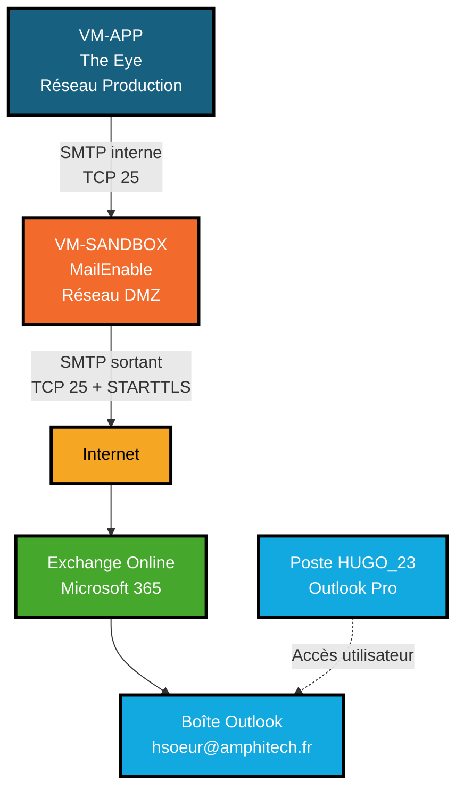

# Spécification technique — Propagation des alertes par e-mail

## 1. Objectif

Cette spécification décrit l'architecture et les prérequis nécessaires pour transmettre les alertes de The Eye vers une boîte Outlook hébergée par Microsoft 365.

Le système retenu est :

```text
The Eye
    → relais SMTP MailEnable en DMZ
    → Exchange Online / Microsoft 365
    → boîte Outlook
```

The Eye ne communique pas directement avec Microsoft 365. Il remet les messages à un relais SMTP interne, qui est le seul composant chargé de communiquer avec Internet et Exchange Online.

## 2. Périmètre

La présente spécification couvre :

- l'architecture réseau ;
- le rôle du relais SMTP ;
- la distinction entre Outlook et Exchange Online ;
- les flux réseau nécessaires ;
- la configuration attendue de MailEnable ;
- l'intégration avec Microsoft 365 ;
- les règles de sécurité ;
- les contrôles et tests de validation ;
- les prérequis restant à traiter par l'infrastructure réseau.

Elle ne définit pas encore :

- le contenu détaillé des modèles d'e-mails ;
- les destinataires et groupes d'escalade ;
- les règles de limitation du nombre de notifications ;
- l'implémentation applicative du module de notification dans The Eye.

Le cycle de vie fonctionnel des alertes et des règles est décrit dans [ALERTES-REGLES.md](ALERTES-REGLES.md).

## 3. Architecture retenue



### 3.1 Rôle des composants

| Composant | Localisation | Rôle |
|---|---|---|
| The Eye / VM-APP | Réseau Production | Produit les événements et remet les notifications au relais SMTP |
| MailEnable / VM-SANDBOX | Réseau DMZ | Accepte les messages de The Eye et les relaie vers Microsoft 365 |
| Exchange Online | Datacenters Microsoft | Réceptionne, filtre et remet les messages dans la boîte Microsoft 365 |
| Outlook Pro / HUGO_23 | Réseau bureautique | Client utilisé pour consulter la boîte, sans transporter les messages de The Eye |

La VM de rebond RDP sert uniquement à l'administration. Elle ne doit pas héberger le relais SMTP et ne fait pas partie du chemin applicatif des e-mails.

## 4. Microsoft 365 et Exchange Online

Microsoft 365 / Exchange Online est le service de messagerie hébergé en ligne par Microsoft. Il ne s'agit pas d'un serveur installé sur les serveurs bureautiques de l'entreprise.

Le poste bureautique `HUGO_23` exécute Outlook Pro, mais la boîte est hébergée dans Exchange Online. Outlook se connecte à cette boîte ; il ne sert pas de relais SMTP pour The Eye.

Le domaine `amphitech.fr` possède actuellement l'enregistrement MX public suivant :

```text
amphitech-fr.mail.protection.outlook.com
```

Cette valeur a été vérifiée avec :

```powershell
Resolve-DnsName amphitech.fr -Type MX
```

Le relais MailEnable doit utiliser ce nom DNS comme Smart Host. Les adresses IP retournées par Microsoft 365 ne doivent pas être configurées en dur, car elles peuvent évoluer.

## 5. Configuration cible du relais SMTP

### 5.1 Système et logiciel

| Élément | Valeur |
|---|---|
| Système | Windows Server 2022 Standard |
| Rôle SMTP IIS natif | Désactivé |
| Relais retenu | MailEnable |
| Nom logique du Post Office | `AMPHITECH` |
| Écoute SMTP | TCP 25 |
| Destination sortante | `amphitech-fr.mail.protection.outlook.com` |
| Sécurité sortante | STARTTLS |
| Authentification Microsoft 365 | Aucune à ce stade, connecteur basé sur l'IP publique |

Le rôle SMTP IIS natif a été installé initialement, mais son interface IIS 6.0 a généré une erreur MMC. Il est donc désactivé pour éviter tout conflit avec MailEnable.

La présence du relais MailEnable a été validée localement :

```powershell
Test-NetConnection 127.0.0.1 -Port 25
```

Résultat attendu et obtenu :

```text
TcpTestSucceeded : True
```

Le processus qui écoute actuellement sur le port 25 est `MESMTPC.EXE`, service `MailEnable SMTP Connector`.

### 5.2 Smart Host

Dans les propriétés SMTP de MailEnable :

```text
Smart Host Enabled : activé
IP/Host            : amphitech-fr.mail.protection.outlook.com
Port               : 25
Security           : STARTTLS
Authentication     : désactivée
```

Le relais ne doit pas utiliser `smtp.office365.com:587` dans cette architecture. Ce mode correspond à la soumission authentifiée d'un client SMTP. L'architecture retenue utilise le relais SMTP et un connecteur Exchange Online autorisant son IP publique.

### 5.3 Contrôle du relais

Dans les propriétés SMTP de MailEnable :

- `Allow Mail Relay` doit être activé ;
- `Allow relay for privileged IP ranges` doit être activé ;
- la VM The Eye doit être ajoutée aux IP privilégiées ;
- `Allow relay for local sender addresses` doit rester désactivé ;
- `POP before SMTP authentication` doit rester désactivé ;
- aucune règle ne doit autoriser toutes les adresses IP.

L'adresse actuellement identifiée pour The Eye est :

```text
192.168.1.104
```

Cette adresse doit être confirmée comme l'adresse source réellement visible par MailEnable. En cas de NAT entre la Production et la DMZ, l'adresse à autoriser sera l'adresse après NAT.

## 6. Flux réseau nécessaires

### 6.1 Flux Production vers DMZ

| Source | Destination | Port | Sens | Usage |
|---|---|---:|---|---|
| VM The Eye (`192.168.1.104`) | VM-SANDBOX / MailEnable | TCP 25 | Production → DMZ | Remise des alertes au relais SMTP |

Ce flux doit être limité à l'adresse IP de The Eye. Aucun autre poste de production ne doit pouvoir utiliser le relais.

### 6.2 Flux DMZ vers Microsoft 365

| Source | Destination | Port | Sens | Usage |
|---|---|---:|---|---|
| VM-SANDBOX / MailEnable | `amphitech-fr.mail.protection.outlook.com` | TCP 25 | DMZ → Internet | Relais vers Exchange Online |

Le filtrage doit utiliser le nom DNS, les plages Microsoft 365 officielles ou la méthode de filtrage recommandée par l'équipe réseau. Il ne faut pas figer une seule adresse IP Microsoft 365.

### 6.3 Flux DNS

| Source | Destination | Port | Sens | Usage |
|---|---|---:|---|---|
| VM-SANDBOX / MailEnable | DNS autorisé | UDP 53 et TCP 53 | DMZ → DNS | Résolution du Smart Host Microsoft 365 |

La VM-SANDBOX possède actuellement le DNS `192.168.1.249` sur son interface `amphi-prod`, mais aucune adresse DNS sur son interface `dmz`.

La requête suivante renvoie actuellement `SERVFAIL` depuis la VM-SANDBOX :

```powershell
Resolve-DnsName amphitech-fr.mail.protection.outlook.com -Server 192.168.1.249
```

La résolution DNS externe doit donc être autorisée depuis la DMZ, ou un DNS autorisé doit être fourni à la VM-SANDBOX. L'utilisation directe d'un DNS public comme `1.1.1.1` ne doit pas être mise en place sans validation de la politique de sécurité.

### 6.4 Flux entrants depuis Internet

Aucun flux entrant depuis Internet vers MailEnable ne doit être autorisé.

Le relais doit être utilisé uniquement pour :

```text
The Eye → MailEnable → Microsoft 365
```

## 7. Configuration Exchange Online attendue

Dans Exchange Online, un connecteur doit autoriser les messages provenant du relais MailEnable.

Le connecteur devra être configuré selon la politique Microsoft 365 de l'entreprise, avec au minimum :

- origine : serveur de messagerie de l'organisation ;
- destination : Microsoft 365 ;
- identification du relais par son adresse IP publique fixe ou par certificat ;
- restriction aux expéditeurs autorisés, par exemple `theeye-alertes@amphitech.fr` ;
- TLS activé ou obligatoire selon la politique de sécurité.

L'adresse IP publique utilisée par la VM-SANDBOX pour sortir vers Internet doit être fournie par l'équipe réseau. C'est cette adresse qui devra être déclarée dans le connecteur Exchange Online, et non l'adresse privée de la VM.

La création et la modification du connecteur doivent être réalisées par un administrateur Exchange Online autorisé.

## 8. Adresse d'expédition

Une adresse technique dédiée doit être utilisée pour les notifications, par exemple :

```text
theeye-alertes@amphitech.fr
```

L'utilisation d'une boîte personnelle est déconseillée pour la production, car elle rend le fonctionnement dépendant d'un compte individuel et complique les changements d'équipe.

Les éléments suivants doivent être confirmés avant la mise en production :

- existence de l'adresse technique ;
- autorisation de l'expéditeur dans Exchange Online ;
- adresse de réponse (`Reply-To`) ;
- destinataires initiaux ;
- politique de conservation et de supervision de cette boîte.

## 9. Sécurité

Le relais SMTP doit respecter les exigences suivantes :

- ne pas être un relais ouvert ;
- limiter les clients SMTP à The Eye ;
- n'accepter aucun flux SMTP entrant depuis Internet ;
- ne pas stocker de mot de passe Microsoft 365 si l'autorisation par connecteur est retenue ;
- utiliser STARTTLS pour la connexion sortante ;
- conserver les journaux SMTP et les protéger contre les suppressions non autorisées ;
- limiter les droits d'administration de MailEnable ;
- appliquer les mises à jour Windows et MailEnable selon la politique de maintenance ;
- surveiller les files d'attente entrantes et sortantes ;
- prévoir une procédure de désactivation immédiate du relais en cas d'abus.

## 10. Tests de validation

### 10.1 DNS depuis la DMZ

Depuis la VM-SANDBOX :

```powershell
Resolve-DnsName amphitech-fr.mail.protection.outlook.com
```

Le nom doit être résolu en une ou plusieurs adresses Microsoft 365.

### 10.2 Connectivité TCP vers Microsoft 365

Depuis la VM-SANDBOX :

```powershell
Test-NetConnection amphitech-fr.mail.protection.outlook.com -Port 25
```

Le résultat attendu est :

```text
TcpTestSucceeded : True
```

### 10.3 Connectivité The Eye vers le relais

Depuis la VM The Eye :

```powershell
Test-NetConnection <nom-ou-ip-de-VM-SANDBOX> -Port 25
```

Le résultat attendu est :

```text
TcpTestSucceeded : True
```

### 10.4 Test de relais autorisé

Un test d'envoi doit être effectué depuis The Eye avec :

- une adresse d'expédition autorisée ;
- un destinataire de test ;
- un objet identifiant le test ;
- l'heure du test ;
- la consultation des journaux MailEnable ;
- la vérification de la réception dans Outlook.

### 10.5 Test de relais interdit

Un poste qui n'est pas The Eye doit être incapable d'utiliser le relais SMTP pour envoyer un message. Ce test doit retourner un refus et être visible dans les journaux.

### 10.6 Test de panne

Les scénarios suivants doivent être vérifiés :

- DNS indisponible ;
- port 25 sortant bloqué ;
- Exchange Online indisponible ;
- adresse de destination invalide ;
- relais arrêté ;
- file d'attente sortante persistante.

Le relais doit conserver les messages en attente ou journaliser explicitement l'échec selon sa configuration. The Eye devra ensuite gérer le résultat d'envoi sans considérer une mise en file locale comme une remise définitive.

## 11. Demande à l'infrastructure réseau

La demande doit contenir les éléments suivants :

```text
Source      : VM The Eye — 192.168.1.104
Destination : VM-SANDBOX / relais MailEnable
Port        : TCP 25
Usage       : transmission des alertes The Eye
```

```text
Source      : VM-SANDBOX / relais MailEnable
Destination : Microsoft 365 — amphitech-fr.mail.protection.outlook.com
Port        : TCP 25 sortant
Usage       : relais SMTP vers Exchange Online
```

```text
Source      : VM-SANDBOX / relais MailEnable
Destination : serveur DNS autorisé
Ports       : UDP 53 et TCP 53
Usage       : résolution DNS de Microsoft 365
```

L'équipe réseau doit également communiquer :

- l'adresse IP privée de la VM-SANDBOX ;
- l'adresse IP publique de sortie utilisée par cette VM ;
- le serveur DNS autorisé pour la DMZ ;
- l'existence éventuelle d'un NAT entre Production et DMZ ;
- les règles de filtrage appliquées aux destinations Microsoft 365.

## 12. Critères d'acceptation

La solution sera considérée comme prête lorsque :

1. The Eye peut joindre MailEnable sur TCP 25 ;
2. seul The Eye est autorisé à relayer sans authentification ;
3. la VM-SANDBOX résout le Smart Host Microsoft 365 ;
4. la VM-SANDBOX peut joindre Microsoft 365 sur TCP 25 ;
5. l'IP publique du relais est autorisée dans Exchange Online ;
6. un e-mail de test arrive dans la boîte Outlook ;
7. un client non autorisé ne peut pas relayer ;
8. les journaux permettent de retrouver la remise, l'échec ou la mise en file d'un message ;
9. aucune connexion SMTP entrante depuis Internet n'est possible ;
10. une procédure de désactivation et de reprise est documentée.

## 13. État d'avancement

| Élément | État |
|---|---|
| VM Windows Server 2022 identifiée | Terminé |
| MailEnable installé | Terminé |
| Écoute locale sur TCP 25 | Terminé |
| IP de The Eye ajoutée aux IP privilégiées | Terminé, à confirmer après changement réseau |
| Smart Host Microsoft 365 renseigné | Configuré |
| DNS externe depuis la DMZ | Bloqué, demande réseau nécessaire |
| Flux DMZ → Microsoft 365 TCP 25 | À autoriser |
| Connecteur Exchange Online | À créer ou faire valider |
| Adresse technique d'expédition | À confirmer |
| Test d'envoi réel | En attente des flux réseau |
